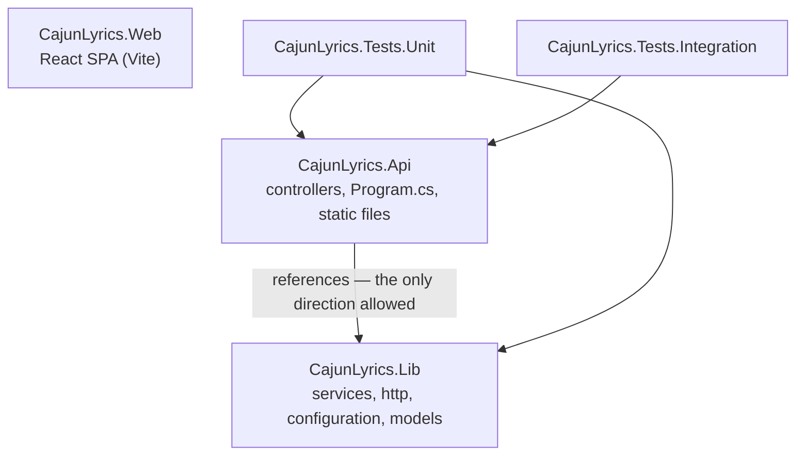
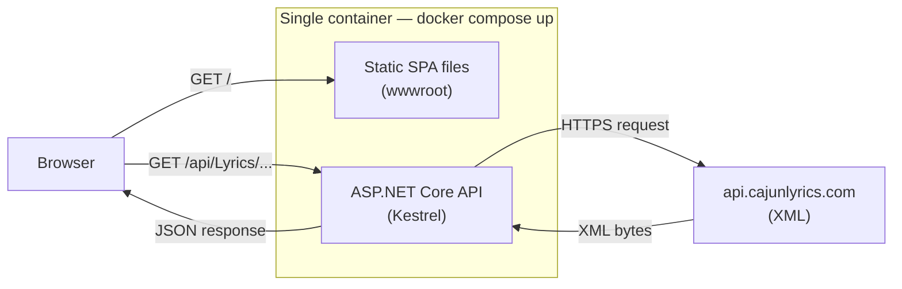
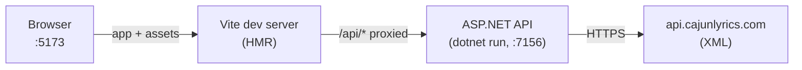

# Architecture

Two apps in one repo: **CajunLyrics.Api** (C# / ASP.NET Core on .NET 10) and **CajunLyrics.Web** (Vite + React 19 + TypeScript), deployed as a single Docker container. The API wraps the external CajunLyrics.com service, which answers in **XML** — responses are fetched as bytes, decoded UTF-8, and deserialized with `XmlSerializer` before the API returns JSON to the browser.

## Project layout and dependency direction

`CajunLyrics.Lib` never references `CajunLyrics.Api`; controllers stay thin and delegate to `ILyricService`. The SPA is independent — the API serves its built output as static files with an `index.html` fallback, which is what makes the single-container deployment possible.

## Request flow (Docker / production)

The SPA and `/api` share one origin (port 8080 in Docker), so the browser never sees CORS or the upstream URL.

## Local development wiring

`npm run dev` (repo root) starts both processes together with `concurrently`:

Vite proxies `/api` to `https://localhost:7156`, accepting the self-signed dev cert — `vite preview` shares the same proxy config. Only the frontend gets hot reload; `dotnet run` does not watch (swap in `dotnet watch` if you want that).

## Testing tiers

- **Unit (NUnit)** — `CajunLyrics.Tests.Unit`, no network. Part of the CI gate.
- **Hermetic integration** — `CajunLyrics.Tests.Integration` runs the real API against a local WireMock stub serving recorded upstream responses (`UpstreamFixtures/`). Part of the CI gate (`integration_tests` job, `TestCategory!=Live`).
- **Live canary** — `Category("Live")` hits the real CajunLyrics.com API on purpose. Excluded from CI, reserved for CD/deploy-time checks: a failure there means upstream changed and the recorded corpus needs refreshing.
